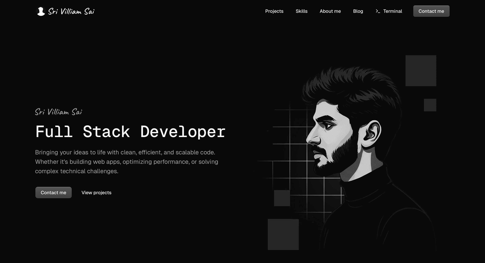
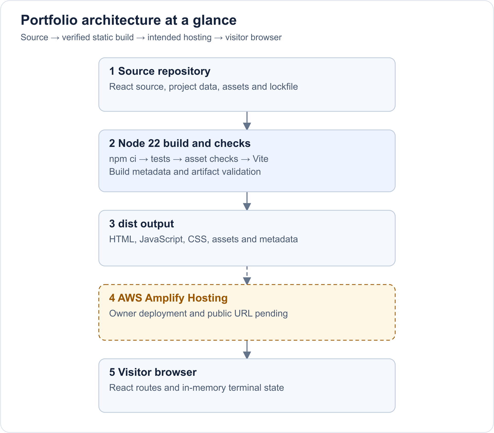

# Sri Villiam Sai — Developer Portfolio

[](https://github.com/srivilliamsai/portfolio/actions/workflows/ci.yml)

My personal developer portfolio, shared for participation in the AWS Student Builder Challenge. It connects Java backend thinking, React interfaces and native iOS work. Visitors can browse projects, skills, open-source contributions and nine articles, or explore the same story through an interactive developer terminal.

The portfolio is a static React/Vite application hosted on AWS Amplify. Its terminal answers portfolio questions using local code and project data; it does not call an AI service.



*Desktop screenshot supplied by the owner on 3 November 2026. The public site is available on AWS Amplify.*

## Review status

| Item | Current status |
|---|---|
| Application | Implemented; 1,832 tests and production build passed, 3 November 2026 |
| Public AWS URL | [Live portfolio](https://main.d229cwpntq8yz1.amplifyapp.com) |
| Source URL | [srivilliamsai/portfolio](https://github.com/srivilliamsai/portfolio) |
| AWS evidence | [Live AWS site](https://main.d229cwpntq8yz1.amplifyapp.com); commit and file verification reported through the Production environment |
| Originality | Previously public portfolio; organizer confirmation required |

A development address is not a public submission URL. Creating a new folder or changing the host does not establish eligibility.

[Evaluation guide](docs/EVALUATION.md) · [Architecture and LLD](docs/ARCHITECTURE.md) · [Testing evidence](docs/TESTING.md) · [Deployment](DEPLOYMENT.md)

## What to explore

- **Projects:** PitStop is the large homepage card; Carbon Footprint and Glassora form the adjacent stack. Wyndra also has its own case study and appears in Skills and the terminal.
- **Skills:** Backend, Web, iOS, and Cloud & tools link capabilities to project evidence.
- **About me:** the Java-to-SwiftUI reflection explains the interests behind the work. Experience, credentials and open-source records provide additional context.
- **Blog:** nine articles include practical walkthroughs and explicitly labelled illustrative writing samples.

## Creative feature: a portfolio you can question

The visible **Terminal** navigation item is the discovery hint. On mobile it is inside the navigation menu. Normal navigation and all core sections remain available without opening it.

1. Open Terminal and enter `story` to read the personal connection between backend logic and native interfaces.
2. Enter `porjects`: a small spelling mistake is corrected and the project information is returned.
3. Enter `glassora`, then `its free`: the follow-up uses the last named project and cites the dated India App Store download-price record.
4. Enter `wyndra`, then `its free`: it explicitly states that pricing is not recorded for that project.
5. Try `help`, `skills`, `oss` or `shortcuts`. Unsupported or ambiguous questions receive a bounded fallback or clarification instead of invented facts.

The feature reflects how I learn: build a small interaction, make its behavior understandable, and connect it to actual work. The reflection in the site is: “I learn by building. Java lets me explore how software works behind the scenes; SwiftUI lets me explore how it feels to use.”

## Architecture at a glance



[Open full-size diagram](docs/diagrams/overview.png) · [Editable SVG](docs/diagrams/overview.svg)

The portfolio has no application server or database. Carbon Footprint's Java backend and the iOS projects' services belong to separate applications; they are not this website's infrastructure. [Full component boundaries, request flow, state lifecycle and design choices](docs/ARCHITECTURE.md).

## Run and verify

Use Node.js 22 and npm, from the repository root:

```sh
npm ci
npm run dev
```

The terminal prints the development address. Development and production are separate; [local setup](docs/LOCAL_SETUP.md) includes the preview commands and optional alternate port.

```sh
npm run verify
```

This runs the included unit tests, asset validation, local documentation links, production build and artifact checks. The latest execution and its limits are documented in [TESTING.md](docs/TESTING.md) and [verification.json](docs/verification.json). Passing tests measure the checked behavior; they are not a competition score.

## GitHub workflows

[Portfolio CI](.github/workflows/ci.yml) verifies Node 22 on Linux, macOS and Windows, saving JUnit/TAP reports and a build for inspection. [Dependency audit](.github/workflows/dependency-audit.yml) checks locked packages; [Dependabot](.github/dependabot.yml) proposes weekly package/action updates. Amplify builds connected pushes. The Production job reports success only after it verifies the published commit and file hashes. See the [CI guide](docs/CI.md).

## AWS implementation

| Configuration | Purpose |
|---|---|
| [Build pipeline](amplify.yml) | Node 22, lockfile install, unit tests, asset validation, Vite build and artifact checks; publishes `dist` |
| [Response headers](customHttp.yml) | Response-header settings and caching for fingerprinted build assets |
| [SPA rewrite](deployment/amplify-rewrites.json) | SPA rewrite rules to apply through Amplify's hosting settings |
| [Site origin](config/site.mjs) | Validates the public deployment origin and creates the sitemap |
| [Vite build](vite.config.js) | Builds route chunks, substitutes metadata and copies required public files |

Set public `VITE_SITE_URL` to the actual Amplify HTTPS origin when deploying. No AWS credential or AI API key is required by the browser application. The AWS service intended for this project is **Amplify Hosting**; no separately provisioned S3, CloudFront, Lambda or database resource is claimed.

## Reviewer and submission documents

- [Evaluation worksheet](docs/EVALUATION.md): qualification gates, evidence mapping and an unofficial 1,000-point review structure using the published weights. No perfect score is claimed.
- [Architecture](docs/ARCHITECTURE.md): high-level design, component diagram and terminal sequence.
- [Testing](docs/TESTING.md): reproducible checks, completed evidence and remaining manual scenarios.
- [Submission draft](docs/SUBMISSION.md): feature explanation, engineering takeaways and the remaining evidence to supply.

The [official challenge page](https://builder.aws.com/build/hackathons/3bff5627-ef21-3bfc-acfc-fce21d39a4f6/aws-student-builder-challenge-build-your-tech-superpower) remains authoritative for requirements and judging. The repository documents implementation and evidence; it does not establish eligibility or guarantee a ranking.

Security controls and review limits are documented in [SECURITY.md](SECURITY.md).
