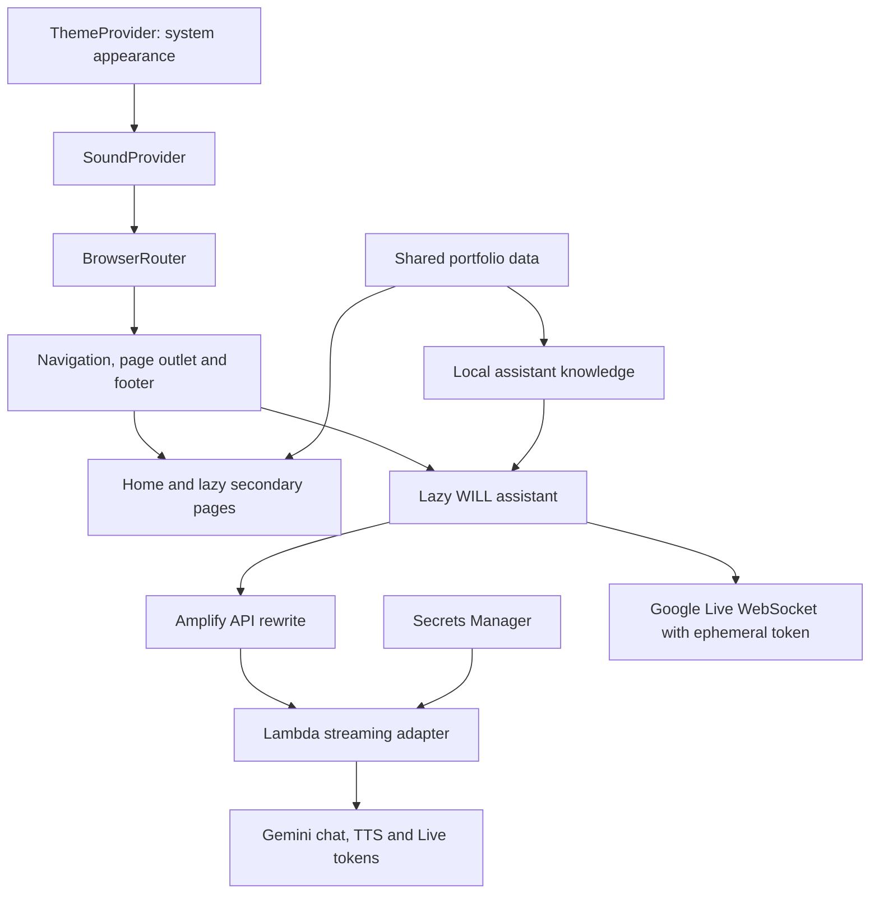

# Architecture and low-level design

Updated for the portfolio release on 6 November 2026. The static frontend and WILL's separately deployed backend have independent release paths.

## Scope and boundaries

The portfolio uses React, React Router, Vite and Framer Motion. Its statically hosted pages present projects, articles, credentials and professional information. The optional WILL backend is separate from the website's static hosting. Carbon Footprint's Java backend and the native apps' content/weather services belong to those projects, not the portfolio.

## Component responsibilities

| Boundary | Responsibility |
|---|---|
| [Route catalog](../src/app/routeCatalog.js) | Canonical paths, redirects and sitemap inputs |
| [App](../src/App.jsx) | Theme and sound providers, router and page registry |
| [Layout](../src/components/layout/Layout.jsx) | Navigation, route fallback, footer, opening animation and WILL overlay |
| [Project data](../src/data/projects.js) | Project summaries, links, scope and responsive cover variants |
| [Project card](../src/components/portfolio/ProjectCard.jsx) | Shared homepage and collection card; separate tall and landscape art |
| [Local assistant knowledge](../src/services/assistantKnowledge.js) | Portfolio answers from shared facts and media records |
| [WILL](../src/components/assistant/VillTour.jsx) | Typed/voice interaction, transcript and image gallery |
| [Window controls](../src/components/common/WindowControls.jsx) | Generic close, minimize and maximize controls for WILL's transcript |

The homepage features PitStop, Invoice Picker and Glassora. View all projects opens `/projects` with all six projects. Case studies and WILL read the same shared project records. The Developer Terminal, its provider, shortcut, commands, history, games and windows have been removed.

## Appearance and assets

ThemeProvider follows the operating system's appearance and listens for changes. Project cover art uses the approved grayscale treatment in both modes. PitStop uses a dedicated portrait source in its tall desktop homepage card and a landscape source in mobile, collection and related-project cards. Skill logos, the WILL launcher, Workday logo and call-calendar illustration retain the approved monochrome appearance. The four-column skills grid uses compact 80px rows on phones.

## Assistant lifecycle

WILL opens from its header launcher. Opening it makes the surrounding page inert; closing it stops capture/playback and restores focus without scrolling to a visible launcher or menu control. A document scroll lock restores the captured position only if the URL has not changed. The transcript reuses generic window controls independently of any other feature. Typed conversation remains in memory for the page session. Opening WILL requests a local microphone preview when permission is needed; recognition/provider voice begins after Start talking. Type instead and closing stop capture. Provider behavior and configuration are documented in [VILL.md](VILL.md).

## Routes and hosting

The build resolves the configured site origin, generates `sitemap.xml` and `robots.txt`, and creates entry-page canonical/social metadata. The client SEO component updates page metadata after navigation. This is a client-rendered SPA; crawlers that do not execute JavaScript may not see page-specific content. The supplied Amplify rewrite returns the SPA for application routes while preserving file asset delivery. Unversioned static assets are not declared immutable.

The [Lambda adapter](../server/assistantLambda.mjs) maps Function URL requests to the existing Node handler without starting a local HTTP listener. It preserves streamed chat and binary WAV responses, refreshes the private secret, and stops work on disconnect. The [deployment packager](../scripts/package-assistant.mjs) bundles the handler and approved knowledge into the uploadable CloudFormation template. A scoped custom resource adds the assistant rewrite before existing Amplify rules and removes only its own route during deletion. Frontend pushes and backend stack updates are separate operations; see [the connection guide](../deployment/CONNECT_WILL.md).

## Verification boundaries

`npm run verify` checks the application tests, 2,472 unique local WILL questions, the reachable import graph, active public assets, local documentation links, production build and distribution metadata. Browser checks cover navigation, responsive cover sources, light/dark presentation and WILL transcript controls. Local verification does not certify physical devices, assistive technology, public deployment or unrelated native-app backends. Earlier diagrams and reports dated before this revision are historical records.

## Navigation and caption timing

[Scroll restoration](../src/services/scrollRestoration.js) owns a bounded map of history-entry positions and temporarily disables competing native restoration. Departure snapshots are captured before click/pop navigation, so a shorter page cannot overwrite them after DOM commit. POP restores an existing position instantly; an unvisited fragment resolves after its lazy route mounts. New navigation, wheel/touch/pointer input and scroll keys cancel pending fragment work. Explicit links retain smooth scrolling unless reduced motion is requested.

[Project detail answers](../src/services/assistantProjectDetails.js) select the requested case-study section, retain its approved scope and choose matching media. [Caption timing](../src/services/assistantCaptions.js) stops estimated word timers once native boundary events are available, preventing timers from advancing through speech pauses. Aman’s rate and voice remain pinned. Cloud PCM captions still use estimated word timing against the audio clock, not provider-supplied word timestamps.
