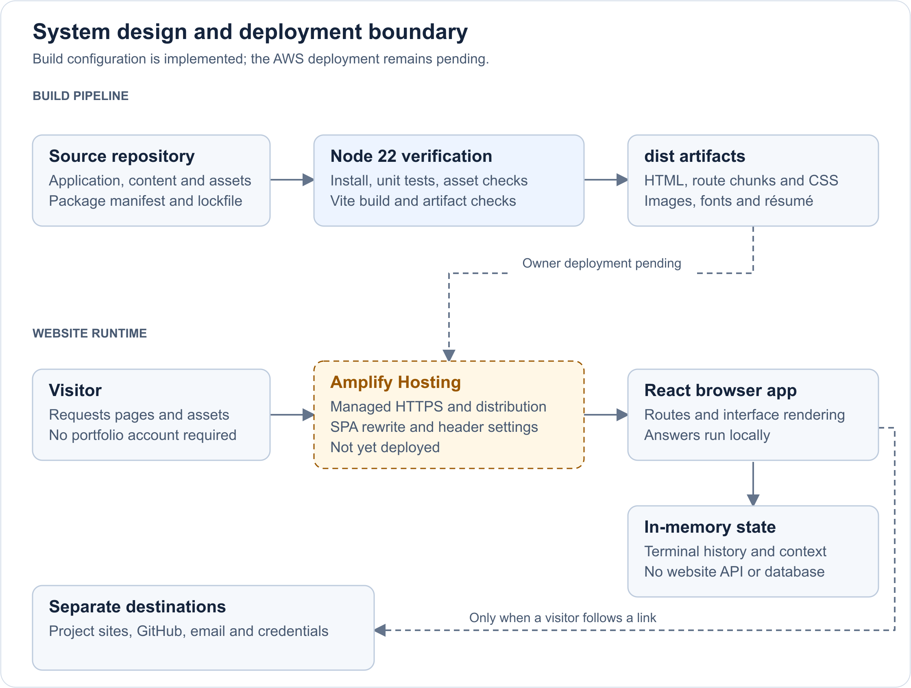
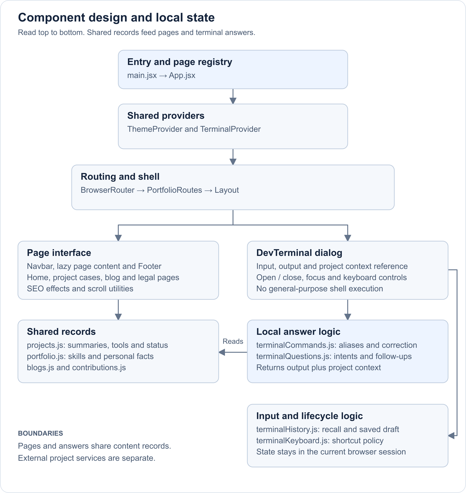
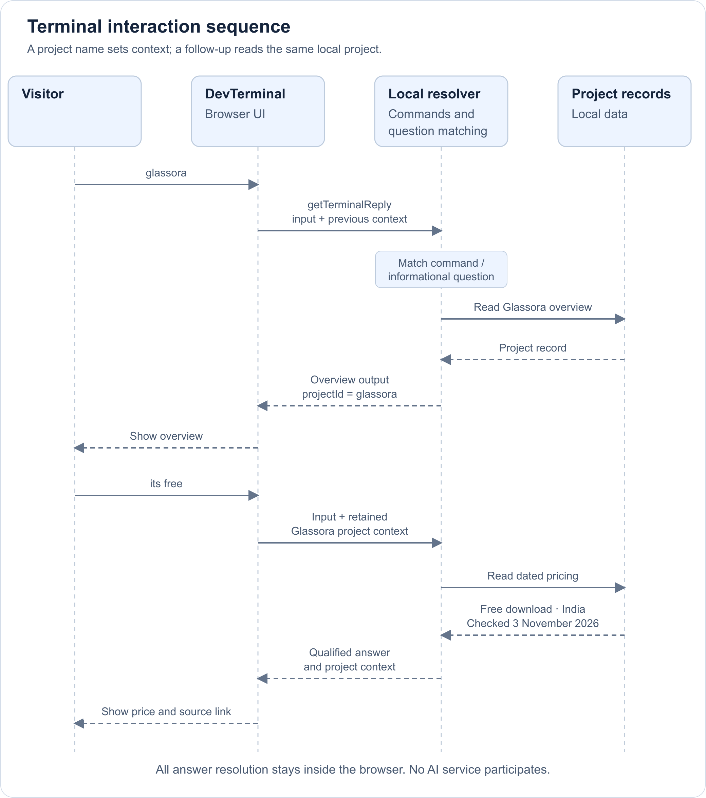

# Architecture and low-level design

This describes the inspected portfolio implementation on 3 November 2026. AWS nodes are the intended deployment, not evidence of an already provisioned service.

The diagrams are rendered images, so the document does not require Mermaid support. Open a full-size image to read fine detail; SVG versions remain scalable and editable. The original Mermaid notation is preserved in each SVG file’s metadata.

## Scope and system boundary

The product is a read-only personal portfolio with browser-local interactions. It uses React 19, React Router, Vite and Framer Motion. The application contains 42 source files, 18 canonical routes and 51 referenced public assets. Nine of the routes are individual articles.

The website does not host the projects it describes. Carbon Footprint's Java service, Wyndra's weather provider, and Glassora's Firebase/Cloudflare content services remain outside this portfolio's runtime. Links to those projects, email, social profiles and credentials are outbound destinations.

[Open full-size diagram](diagrams/system-design.png) · [Editable SVG](diagrams/system-design.svg)

Only Amplify Hosting is intended to be configured for this portfolio. Managed hosting/distribution is not presented as separately created S3 or CloudFront resources. There is no website API, account system, AI endpoint or application database.

## Component structure

[Open full-size diagram](diagrams/component-design.png) · [Editable SVG](diagrams/component-design.svg)

| Boundary | Responsibility and implementation |
|---|---|
| Routes | Canonical paths, redirects and sitemap inputs — [route catalog](../src/app/routeCatalog.js) |
| Shared shell | Navigation, page fallback, footer and terminal overlay — [Layout](../src/components/layout/Layout.jsx) |
| Page registry | Eager Home and lazy secondary pages — [App](../src/App.jsx) |
| Content | Project summaries, tools, facts, pricing and contribution links — [data records](../src/data) |
| Terminal UI | Input/output, focus, suggestions and conversation reference — [dialog](../src/components/terminal/DevTerminal.jsx) |
| Answer logic | Command correction and question/follow-up resolution — [commands](../src/services/terminalCommands.js), [questions](../src/services/terminalQuestions.js) |
| Input state | Recall index, saved draft and edit/execute transitions — [history reducer](../src/services/terminalHistory.js) |
| Keyboard | Completion, execution, clear/cancel and recall policy — [key mapping](../src/services/terminalKeyboard.js) |

The homepage feature selection is PitStop, Carbon Footprint and Glassora. Project case studies and terminal answers read the same project records, which limits description drift. Some longer page narratives remain authored separately; they still need content review when a project changes.

## Terminal request sequence

[Open full-size diagram](diagrams/terminal-sequence.png) · [Editable SVG](diagrams/terminal-sequence.svg)

No network service participates in this sequence. Ordinary static files may still load as part of browsing; following an external link is a separate visitor action.

### Matching and ambiguity

`getTerminalReply(input, context)` returns `{ output, context }`. Command resolution runs first; exact aliases and unique nearby spellings select a known command. The spelling matcher handles insertion, omission, substitution and adjacent transposition. Tied matches produce suggestions rather than silently choosing an answer.

If no command matches, the informational resolver normalizes a bounded vocabulary. Its question path rejects inputs above 400 characters or 65 words and declines command chains/code-like input. This is a small deterministic matcher, not open-ended natural-language understanding. Multiple project/topic matches request clarification. Unknown personal details and unrecorded prices are explicitly left unknown.

### State lifecycle

| State | Owner and lifecycle |
|---|---|
| Dialog | TerminalProvider owns open/closed state and return focus for the page session |
| Output | DevTerminal retains output and maximize state when closed; reload resets them |
| Project | conversationRef stores the named project; unrelated, unsupported, ambiguous input or output clearing resets it |
| Input history | The reducer tracks input, recall index and draft; leaving recall restores the draft, editing creates a new draft |
| Appearance | ThemeProvider follows the operating system’s color preference and listens for changes |

The terminal does not persist questions to storage or a remote service. History is not a real operating-system shell and never executes typed commands. Output is rendered as React text with recognized email/URL links; the blog's authored HTML is a separate, source-controlled content path.

## Routes, metadata and assets

The build resolves `VITE_SITE_URL` and requires a public HTTPS origin under the Amplify build guard. It generates `sitemap.xml`, `robots.txt` and entry-page canonical/social metadata. The shared route catalog provides the sitemap's paths. After navigation, the `SEO` component updates document metadata in the browser.

This is a client-rendered SPA, not a server-rendered or prerendered site. Crawlers that do not execute JavaScript may not see article-specific metadata or content. A generated sitemap does not guarantee indexing. `NotFound` displays a missing-page view and sets client-side noindex; the hosting SPA fallback may still return HTTP 200.

The owner must apply the supplied 200 rewrite in Amplify. Application paths receive the SPA entry; file extensions for scripts, styles, images, fonts, JSON, PDF and XML bypass that fallback. `customHttp.yml` requests response headers and long caching for fingerprinted `/assets/` files. Unversioned `/static/` assets are not declared immutable.

## Design choices, limits and next steps

- Static hosting and local answers keep the portfolio reproducible without an AI account or backend. The tradeoff is a deliberately limited question vocabulary and manually maintained facts.
- Local shared records keep core summaries consistent; third-party credentials, links and project implementation claims still need periodic owner verification.
- Native controls, focus handling, a skip link, reduced-motion-aware scrolling and a mobile menu are implemented. Source inspection is not assistive-technology certification.
- Terminal history grows during a session. A bounded history policy would be a reasonable later improvement for unusually long sessions.
- No measured latency, availability, cost, security audit, native-app test count or live AWS performance claim is established by this repository's portfolio tests.
